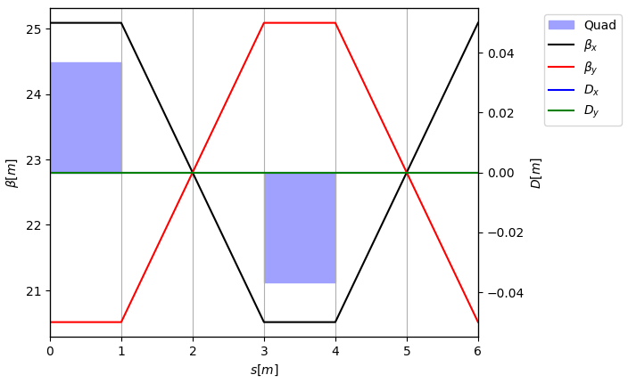

# Xsuite CAS Hands-On Setup Instructions

In the hands-on we will use Xsuite, in particular, for a smooth and consistent experience we recommend setting it up in a fresh conda environment. These instructions will walk you through the procedure. They largely mirror https://xsuite.readthedocs.io/, which you can also consult for more information.

## Step 0: If you are on Windows

Xsuite on Windows is supported through the Windows Subsystem for Linux (WSL). This requires admin rights to install (unless your administrator has already provided it on your system) and a couple GB of free disk space.

See below the install instructions for WSL. If you already have a working WSL Linux distribution running on your machine, proceed to step 1, executing all the commands in the WSL prompt. If you neither have WSL, nor the ability to install it, please reach out to us before the hands on to find an alternative solution.

### Install WSL

Open PowerShell in administrator mode by right-clicking and selecting _Run as administrator_, enter the `wsl --install` command, then restart your machine. By default this will install an Ubuntu distribution in Windows. In the subsequent steps execute all commands in the Linux shell, which can be found by searching *Ubuntu* in the Start menu.

For more information and troubleshooting see https://learn.microsoft.com/en-us/windows/wsl/install.

## Step 1: Install Miniforge

Run the following commands in your command prompt:

```bash
curl -L -O "https://github.com/conda-forge/miniforge/releases/latest/download/Miniforge3-$(uname)-$(uname -m).sh"
bash Miniforge3-$(uname)-$(uname -m).sh
```

The installation process will ask you a few questions. Answer `yes` to accept the licence terms, and specify your preferred conda installation location: the default is fine. You can answer `yes` to initialising your default shell. (It's okay to run the suggested command to disable auto-activation of the base environment in your shell if you'd like.) Restart your shell for the changes to take effect.

## Step 2: Create a new conda environment

Run the following commands in your command prompt:

```bash
mamba create -n xsuite_env python=3.14
```
This will pull the required conda packages and set up `conda_env` as a Python 3.14 environment.

Once the installation has finished successfully, activate your new environment:

```bash
mamba activate xsuite_env
```

## Step 3: Install Xsuite

The following command will install Xsuite together with Jupyter (for notebooks), and Xplt (for plotting):

```bash
pip install xsuite xplt jupyter
```

## Step 4: Check that everything works

Open Jupyter with:
```bash
jupyter notebook
```

Create a new notebook. Paste the following in the first cell, and execute:

```python
import xtrack as xt

env = xt.Environment()
env.particle_ref = xt.Particles(p0c=1e9, mass0=xt.PROTON_MASS_EV)

# Variables and element definitions
env['kq'] = 0.1
env.new('qf', xt.Quadrupole, length=1.0, k1='kq')
env.new('qd', xt.Quadrupole, length=1.0, k1='-kq')
env.new('d', xt.Drift, length=2.0)

# Build a FODO cell
line = env.new_line(name='fodo', components=[
    env.place('qf'), env.place('d'),
    env.place('qd'), env.place('d'),
])

# Plot the twiss
tw = line.twiss(method='4d')
tw.plot()
```

If everything was successful, you should see a simple twiss plot appear:


